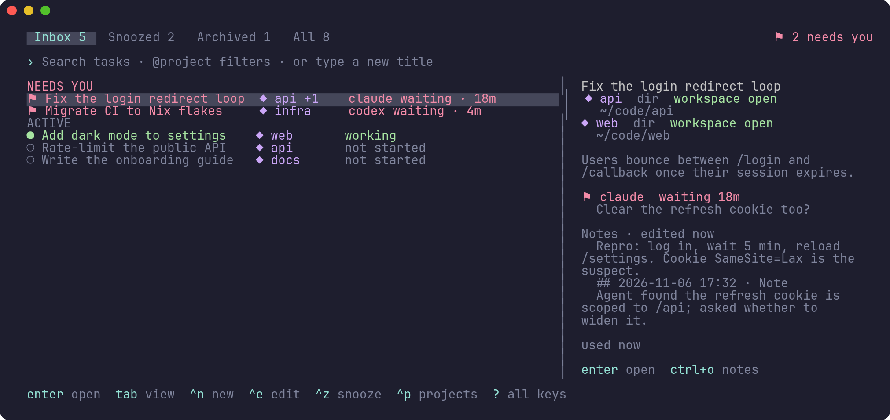
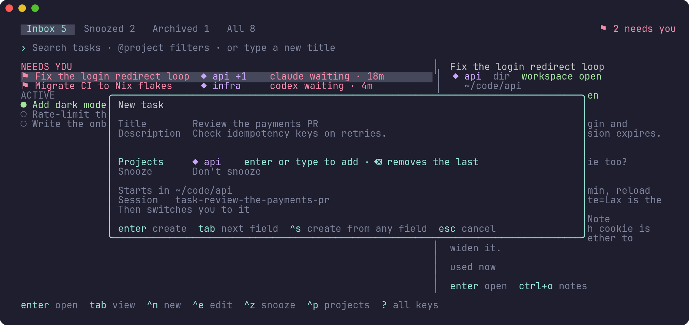
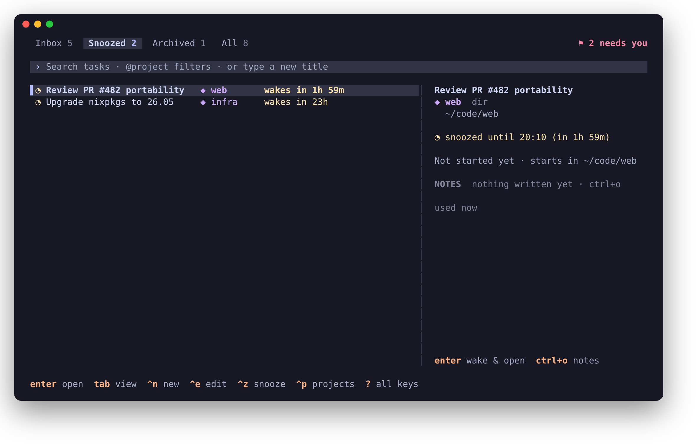
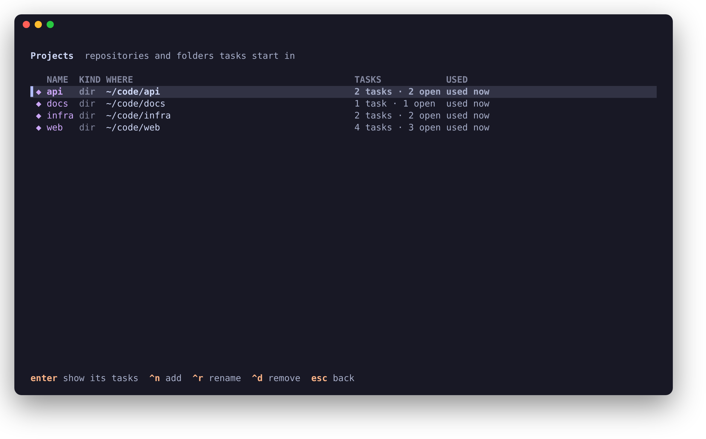

<div align="center">

# 📥 inbox-task-manager

**A blazingly fast ⚡ inbox for your [Herdr](https://herdr.dev) sessions and the agents in them, written in Rust 🦀**

[](https://github.com/eloback/inbox-task-manager/actions/workflows/ci.yml)
[](Cargo.toml)
[](https://herdr.dev)
[](flake.nix)
[](LICENSE)



</div>

Each task is a Herdr session named `task-<slug>` with its own panes and
agents. `itm` lists them like an inbox, with the tasks whose agents are
waiting for you first, and switches between them in place.

## ✨ Features

- ⚡ **Blazingly fast.** One small native binary: the switcher is up before
  you have let go of the key, and `itm status` is cheap enough for a status
  bar that asks every second. It talks to Herdr over its socket API instead
  of starting the `herdr` CLI for every query.
- 📥 **Inbox first.** Tasks with an agent waiting for input come first, with how
  long it has waited. A daemon notifies you when an agent gets blocked in
  another task.
- 😴 **Snooze, archive, reopen.** Snooze a task until a time or until one of its
  agents needs you; archive it to stop its session and reopen it later, with
  Herdr restoring the layout and resuming its agents.
- 📁 **Projects.** Save git repositories (cloned for you) and folders once, and
  give a task one or more of them: its session starts with a named Herdr
  workspace per project. The daemon keeps a running task's projects in step
  with the workspaces you open and close (a setting).
- 📝 **Notes.** Every task has a markdown file for its context, kept through
  archive and reopen.
- 🔀 **Switch in place.** From a Herdr popup, the switcher moves your terminal to
  another task without nesting clients.
- 🦀 **Written in Rust.** No runtime to install, `unsafe` code denied
  crate-wide, 300+ tests, and end-to-end runs against a real Herdr.

Binary: `itm`. Run `itm` for the task switcher.

## 📸 Screenshots

<table>
  <tr>
    <td width="50%"></td>
    <td width="50%"></td>
  </tr>
  <tr>
    <td align="center"><b>New task</b>: one form, projects from a fuzzy finder</td>
    <td align="center"><b>Snoozed</b>: back on a timer, or when an agent asks</td>
  </tr>
  <tr>
    <td colspan="2"></td>
  </tr>
  <tr>
    <td colspan="2" align="center"><b>Projects</b>: repositories and folders your tasks start in</td>
  </tr>
</table>

## 📋 Requirements

- Linux (NixOS included). macOS and the BSDs are not supported.
- [Herdr](https://herdr.dev) 0.9.3 or later.
- `git`, for repository projects.
- To build it: Rust 1.89 or later (`cargo`; CI checks that version), or Nix.
- Optional: `notify-send` for desktop notifications. GNU `date` (not
  BusyBox's) for snooze phrases beyond the ones itm reads itself (see
  [Snooze times](#snooze-times)).

## 📦 Install

With cargo, from a clone of this repository (itm goes to `~/.cargo/bin`):

```sh
cargo install --locked --path .
```

With Nix, the flake has a package, an overlay and a home-manager module:

```sh
nix run <flake-ref>   # try it; <flake-ref> is this repository, e.g. . in a clone
```

```nix
# flake.nix
inputs.inbox-task-manager.url = "<flake-ref>";

# home-manager configuration
imports = [ inputs.inbox-task-manager.homeModules.default ];
programs.inbox-task-manager.enable = true;   # the CLI and its daemon
```

The module installs itm and runs `itm daemon` as a systemd user service;
`programs.inbox-task-manager.daemon.enable = false`
leaves the service out. The service gets your profile's `PATH` and
home-manager's XDG folders, so it sees the same tasks and Herdr sessions as
your shell. The package puts git, GNU `date` and `notify-send` on itm's
`PATH`, and adds Herdr only as a fallback after yours: the Herdr client must
match the running server's version. The flake builds for x86_64-linux and
aarch64-linux.

**Upgrading from the Python itm** (0.2.0): the Rust itm reads and writes
the same files, so tasks, projects, notes and settings carry over.
Uninstall the Python one (`pipx uninstall inbox-task-manager`, or `uv tool
uninstall inbox-task-manager`), install this one, and restart the daemon
(an `itm attach` loop of the Python itm still counts as an itm client
until you close it). The command is
`itm` only: scripts that ran `inbox-task-manager` need `itm`. The
switcher draws with your terminal's colors (`ITM_THEME` is gone).

## 🛠️ Setup

1. **Run the daemon.** It notifies about blocked agents and wakes snoozed
   tasks. The home-manager module does this for you. Otherwise use
   [`contrib/systemd/inbox-task-manager.service`](contrib/systemd/inbox-task-manager.service),
   which explains how to install it.
2. **Add the Herdr keys.** Copy
   [`contrib/herdr-keys.toml`](contrib/herdr-keys.toml) into your Herdr config
   (`~/.config/herdr/config.toml`). It also turns on Herdr toasts
   (`[ui.toast] delivery = "herdr"`), which itm uses for notifications in the
   attached session.
3. **Attach through itm.** Start Herdr with `itm attach` instead of `herdr`
   (an alias such as `alias hr='itm attach'` helps). Only clients started this
   way can be switched in place: Herdr cannot nest clients and has no API to
   detach one, so itm runs the client in a loop and restarts it on the
   chosen task.
4. **Let Herdr resume agents** (optional). Archive, reopen and restarts rely on
   Herdr restoring layouts; it resumes an agent only when its integration is
   installed (`herdr integration install claude`, and so on). Without it,
   restored panes come back as plain shells. Codex asks once to approve new
   hooks (`/hooks`).

## 🚀 Usage

```sh
itm                          # the task switcher
itm new "Fix the login bug" -p api -p web -d "Users get logged out after 5 min"
itm attach [task]            # attach outside Herdr, or switch inside it
itm snooze [task] 2h         # or: tomorrow 9:00, friday 2pm, --until-agent
itm wake | archive | reopen | delete <task>
itm edit <task> --title "…" --add-project api   # --remove-project, --project (sets), --no-project
itm notes [task]             # open notes.md; --append TEXT, --path
itm jump                     # the task whose agent has waited longest
itm last                     # back to the previous task
itm project add git git@github.com:acme/api.git
itm project add dir ~/src/scratch --name scratch
itm project add name "Client X"   # only a name; give it a folder later
itm project set "Client X" --dir ~/code/client-x   # or --no-dir
itm project add-workspace    # the Herdr workspace you are in, for the current task
itm project list | rename | remove
itm list --json              # for scripts; itm status for a bar or title
itm current                  # the Herdr session this terminal is in
```

`itm --help` and `itm <command> --help` list every option.
[REQUIREMENTS.md](REQUIREMENTS.md) describes each behavior in detail.

### Snooze times

itm reads `30m`, `2h`, `1h30m`, `2d`, `45` (minutes), `14:30` or `5pm` (the
next time the clock shows it), `today 17:00`, `tomorrow 9:00`, `friday 2pm`,
`next mon`, and `2026-12-01 14:30`. Other phrases (`next week`, …) go to GNU
`date -d` when it is installed. The snooze dialog offers presets.

### Keys

Herdr, with [`contrib/herdr-keys.toml`](contrib/herdr-keys.toml):

| Key              | Action                          |
|------------------|---------------------------------|
| `prefix+shift+s` | task switcher                   |
| `prefix+t`       | New task form                   |
| `prefix+shift+z` | snooze the current task         |
| `prefix+i`       | task whose agent waited longest |
| `prefix+shift+e` | notes of the current task       |
| `prefix+shift+a` | save this workspace as a project of the task |
| `prefix+tab`     | previous task (replaces Herdr's pane cycling) |

Switcher (`?` with an empty search, or F1, shows them all):

| Key                 | Action                                        |
|---------------------|-----------------------------------------------|
| typing              | search titles; `@name` filters by project     |
| ↑ ↓ / Ctrl+K Ctrl+J | move (Ctrl+K/J also in Projects and snooze)   |
| Enter               | open · wake & open · reopen · create          |
| Tab / Shift+Tab     | next / previous view                          |
| Alt+1…9             | open row 1–9                                  |
| Ctrl+N              | New task form                                 |
| Ctrl+Z / Ctrl+U     | snooze / wake                                 |
| Ctrl+E              | edit title, description and projects          |
| Ctrl+A / Ctrl+D     | archive (asks when running) / delete (asks)   |
| Ctrl+P              | projects                                      |
| Ctrl+O              | notes of the task in your editor              |
| Ctrl+S              | settings (Herdr integration)                  |
| `?` / F1            | all keys (`?` while the search box is empty)  |
| Esc                 | close                                         |

In the switcher's search box, Ctrl+A, Ctrl+E, Ctrl+D, Ctrl+U and Ctrl+K are
taken by these actions; Home, End, Delete and Shift selection still edit the text.

### Projects and workspaces

A task's first project is where its session starts; each project gets a
Herdr workspace named after it on the first start, and one opens when you
add a project to a running task. Herdr renames a workspace without a name
whenever the first pane of its first tab changes folder; a named one keeps
its name.

Workspaces are one source of a task's projects. With **projects follow
workspaces** on, the daemon adds to a running task every saved project a
workspace of its session is in: a workspace named after a project belongs to
it, any other is judged by that same first pane's folder (a tab or pane you
open to look at another repository does not count). A Herdr worktree of a
project, or your own checkout of the same repository (same `origin`), counts
as that project too. With **remove a project
when its workspace closes** on, a project found this way leaves the task again
when its workspace closes; projects you added yourself stay. Only saved
projects count: a workspace in your home folder is in no project unless you
saved the home folder itself.

To make a new workspace a project, open it in Herdr and press
`prefix+shift+a`: itm saves its folder (the add dialog lets you name it),
names the workspace after the project, and adds it to the task (as found in
that workspace while projects follow workspaces). Your home folder and the
folders above it are refused there; `itm project add dir ~` saves it if you
really want it.

A project can also be just a name (`itm project add name`, the add dialog's
"Name only" tab, or "+ New project" in the project finder): it gets no
workspace and counts only for workspaces named after it. To give it a folder,
press `prefix+shift+a` in a workspace named like it (itm asks first), or run
`itm project set <name> --dir <folder>`.

### Settings

`~/.config/inbox-task-manager/config.toml` (`$XDG_CONFIG_HOME`), also changed
from the switcher's Settings screen (Ctrl+S), which keeps your comments:

```toml
[herdr]
projects_from_workspaces = true            # a running task's projects follow its workspaces
remove_projects_without_workspace = true   # ...and a project found there leaves when its workspace closes
```

The daemon reads it on every pass, so changes apply without a restart.

Project finder (the task form's Project field: Enter or start typing): typing
narrows the saved projects; `~/`, `/` or `./` lists folders, Tab goes into the
highlighted one and Enter adds it (or picks it when saved); ↑ ↓ / Ctrl+K Ctrl+J
move; Enter chooses; Esc goes back without changing the project.

## ⚙️ Configuration

| Variable             | Effect                                                                    |
|----------------------|---------------------------------------------------------------------------|
| `ITM_PROJECTS_DIR`   | where repositories are cloned (default `$XDG_DATA_HOME/inbox-task-manager/projects`) |
| `ITM_TASK_DIR`       | where a task without a project starts (default `$HOME`)                   |
| `ITM_NOTIFY_COMMAND` | desktop notification command; gets the title and body as arguments       |
| `ITM_POPUP`          | set in Herdr popups: errors stay on screen for 2.5 s                      |
| `VISUAL`, `EDITOR`   | the editor for notes (else nvim, vim, vi or nano)                         |

Files:

- `$XDG_STATE_HOME/inbox-task-manager/tasks.json`: tasks and projects
  (`~/.local/state` by default).
- `$XDG_DATA_HOME/inbox-task-manager/`: clones (`projects/`) and notes
  (`tasks/<session>/notes.md`) (`~/.local/share` by default).
- Runtime files (switching markers, the daemon's status cache):
  `$XDG_RUNTIME_DIR/inbox-task-manager`, else `/run/user/<uid>/inbox-task-manager`,
  else `/tmp/inbox-task-manager-<uid>`. The daemon and your shell
  must agree on `XDG_CONFIG_HOME` (where Herdr keeps its sessions),
  `XDG_STATE_HOME`, `XDG_DATA_HOME` and `XDG_RUNTIME_DIR` when you set them.

## 💻 Platform notes

- **Linux only**, NixOS included: itm reads the process table from `/proc`
  and relies on how Linux handles Unix sockets and signals. macOS and the
  BSDs are not supported (DESIGN.md section 4).
- **Notifications elsewhere** (a phone, a chat): set `ITM_NOTIFY_COMMAND` to
  a program that takes the title and body as its last two arguments.

## 🧑‍💻 Development

```sh
nix develop                                   # the Rust toolchain, git, tmux, socat, Herdr
cargo fmt --check && cargo clippy --all-targets -- -D warnings && cargo test
nix flake check                               # the same, in Nix's build sandbox
```

Without Nix, any Rust toolchain from 1.89 with clippy and rustfmt works (CI
uses 1.95.0). The end-to-end checks against a real headless Herdr run in a
sandbox, never against your sessions: `cargo build --release`, then
`scripts/sandbox.sh e2e scripts/smoke.sh` (DESIGN.md section 6).
Read [DESIGN.md](DESIGN.md) before changing itm: it records the Herdr facts
itm depends on, the rules that keep switching and task data safe, the UX
principles, and how to test without touching your real sessions.
[REQUIREMENTS.md](REQUIREMENTS.md) lists what itm must do.

## 📄 License

[MIT](LICENSE)
